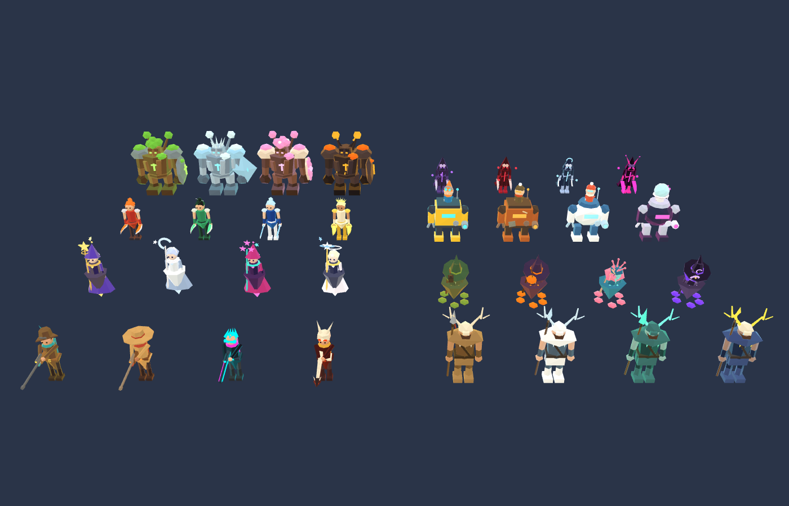
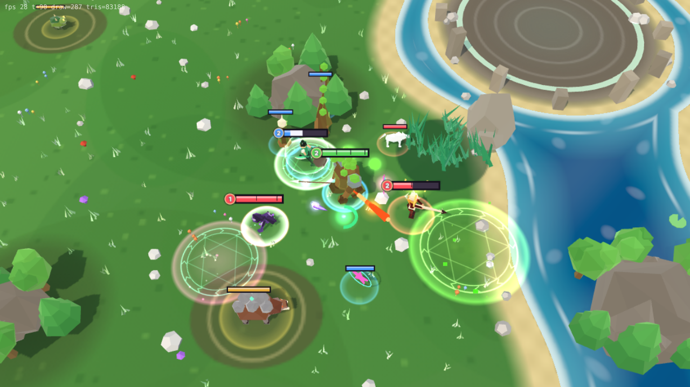
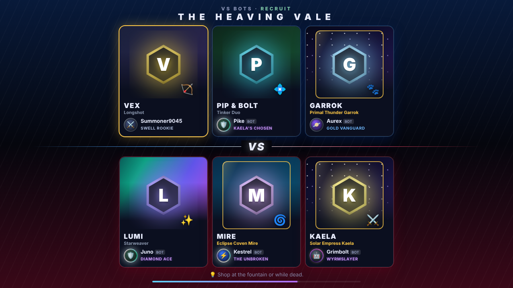

# Groundswell

**A free 3v3 browser MOBA where the battlefield itself rises, floods and burns.**

## ▶ Play now

- **Live game (GitHub Pages):** https://dianteclark.github.io/groundswell/
- **Live game (Claude artifact):** https://claude.ai/artifact/Leom43wi5QTGtKXGkSXkAm

Runs in any modern browser on phone or desktop. No install, no account, no servers — it's one self-contained HTML file.



## What is it?

Groundswell is a League-of-Legends-style MOBA built for the browser, with its own twist: a **living map**. Slay an elemental Wyrm and the ground around its pit swells and transforms for your team — the river floods, the earth catches fire, gales whip through, or stone walls erupt. Mire the Bog Witch can even raise a swamp of her own.

- **3v3** on a two-lane map with a jungle — matches built for the "one more game" loop
- **Vs bots is the main grind** — five difficulties (Recruit → Mythic) and a bot ladder to climb
- **100% free** — everything is earned through play: heroes, skins, relics, sigils, items and profile flair
- **Peer-to-peer play with friends** (planned) — no servers, you only bring what you've earned



## Core systems

| System | How it works |
|---|---|
| **Heroes** | Passive + 2 abilities + ultimate (unlocks at level 5). No mana — cooldowns only. One damage type (**Power**) and one defense (**Armor**). |
| **Augments** | At levels 3 / 6 / 9 pick one of two one-line upgrades to an ability. |
| **Items** | Pick 3 base items in the Armory before the match. In-match each evolves: tier 1 → tier 2 → choose one of two branches. |
| **Relics** | Summoner spell + rune page in one: an active spell with a built-in bonus, plus an **Offense** and a **Utility** Sigil. |
| **Objectives** | **Wyrm** (Ember / Tide / Gale / Stone buffs, 3 = Wyrm Soul, transforms the map) and the **Colossus** (Colossus Might: empowered minions + faster recall). |
| **Progression** | Essence & Prisms, daily/weekly quests, first-win bonus, 30-tier season track, hero mastery, account levels, save export/import codes. |

### Launch roster

| Hero | Role | Hook |
|---|---|---|
| Bram, Ironroot Warden | Tank | Armor builds while standing still; raises walls; grove that drags & roots |
| Kaela, Ember Duelist | Fighter | Builds Heat — overheat to empower abilities at a burn cost |
| Lumi, Starweaver | Mage | Star marks form constellations that detonate |
| Vex, Longshot | Marksman | Every 4th shot pierces; channelled map-range snipe |
| Nyx, Shadowstep | Assassin | Afterimage swap-back dash; blinding invisible dome |
| Pip & Bolt | Support | Gnome + mech: Bolt guards your tethered ally, then crash-lands as an ult |
| Mire, Bog Witch | Controller | Heals in her own zones; ultimate turns the map into swamp |
| Garrok, Beastcaller | Jungler | Wolf companion that grows with every camp cleared |

Each hero ships with 4 skins (default, common, epic, legendary).

## Controls

- **Phone:** left joystick to move · right side: attack + abilities (tap = smart cast, drag = aim) · recall & shop buttons
- **Desktop:** right-click move/attack · A + click attack-move · Q / W / R abilities · D relic · B recall · Space center camera · Y lock camera

## Development

```bash
npm install
npm run build        # → dist/index.html (single self-contained file)
```

- `src/sim/` — deterministic fixed-tick (30 Hz) simulation: map, nav, minions, towers, objectives, combat (lockstep-ready for P2P)
- `src/data/` — heroes, items, relics, sigils, skins (data-driven)
- `src/ai/` — bot AI
- `src/render/` — Three.js low-poly renderer, models, VFX
- `src/ui/`, `src/meta/` — menus, HUD, input, saves, economy
- `tools/` — headless bot-vs-bot balance & smoke tests (`node tools/smoke.mjs`, `sh tools/par.sh 12 3`)
- `docs/index.html` — the built game served by GitHub Pages
- `SPEC.md` — technical contract between systems


